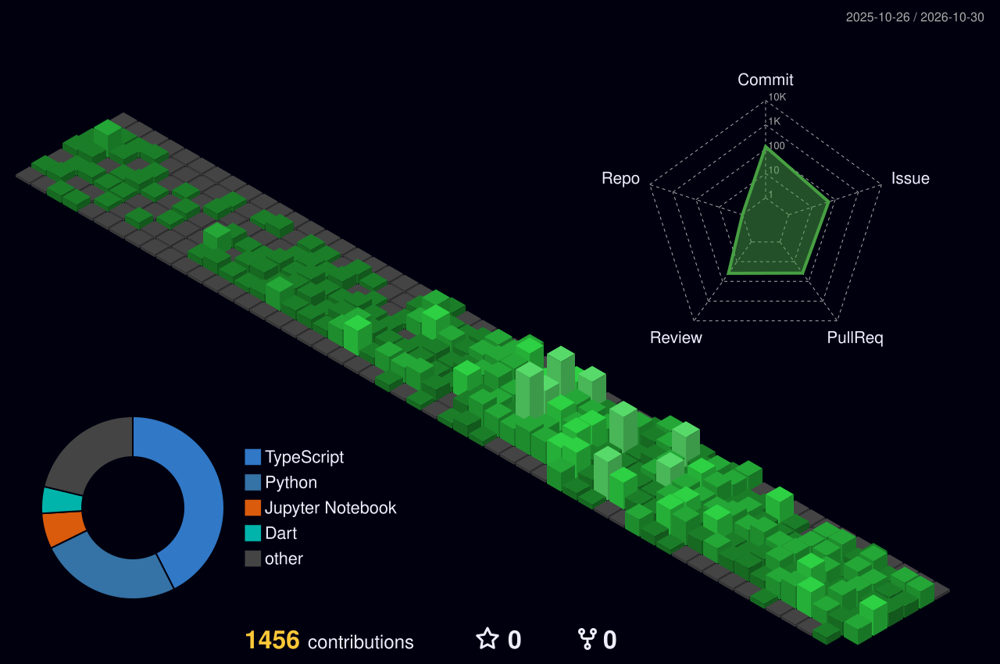

  
  
<b>Building scalable architectures, data pipelines, and impactful digital products.</b>

 

## 🏙️ The city I built this year

  <!-- Esta imagem será gerada automaticamente pela GitHub Action (Passo 2) -->
  <picture>
    <source media="(prefers-color-scheme: dark)" srcset="./profile-3d-contrib/profile-night-green.svg">
    <source media="(prefers-color-scheme: light)" srcset="./profile-3d-contrib/profile-green.svg">
    
  </picture>

 

## 👥 Population (Profile Signals)

  <!-- Cards de Status com tema Dark e Neon Cyan -->
  
  

 

## 🏛️ Landmarks (The Architect Behind the Code)

  
<b>📂 Profile Overview</b>

   
  <ul>
    <li>🎓 <b>Undergrad Student</b>: Data Science for Business at UFPB — Class of 2027.</li>
    <li>💼 <b>Full-Stack Developer</b>: Building microservices and robust integrations at <b>Livvie</b>.</li>
    <li>🔬 <b>Full-Stack Dev & Researcher</b>: Architecting backends and data pipelines at <b>LEMA-UFPB</b> (ODIN platform).</li>
    <li>🎮 <b>Game Dev Enthusiast</b>: Building mechanics with C# in Unity and exploring C++ in Unreal Engine 5.</li>
  </ul>

  
<b>🧠 Architecture & Paradigms</b>

   
  <ul>
    <li><b>Engineering:</b> Clean Architecture, DDD, SOLID, TDD, Spec-Driven Development, Microservices.</li>
    <li><b>AI & Data:</b> NLP, Text Classification, Transformers (BERT), spaCy, basic MLOps.</li>
  </ul>

 

## ⚡ Tech Infrastructure

  

 

## 📍 Visit

  
  

   
  

